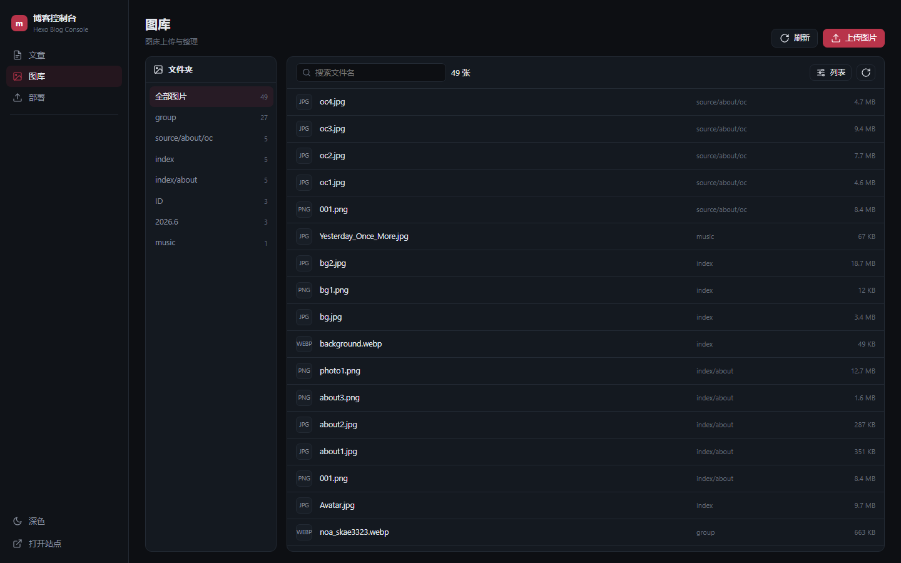

# Hexo Blog Console

给 Hexo 博客用的**本地可视化控制台**：写文章、看预览、一键发布，全程不碰命令行。




> 一个跑在本机的小型 Web 应用（Node + 原生 JS，零额外依赖），只监听 `127.0.0.1`。
> Windows 上双击图标即以无边框窗口打开，像桌面软件一样用。

## 为什么

用 Hexo 写博客，日常动作其实就是三件：新建文件、本地预览、构建部署。但这三件事分别对应
`hexo new`、`hexo server`、`hexo clean && hexo g && hexo d`，每次都要开终端、记命令、等构建。
这个工具把它们变成三个按钮，并且顺手把「源码版本管理」也接上了。

## 功能

- **文章列表**：按日期排序，支持标题 / 标签搜索，显示字数和草稿标记
- **Markdown 编辑**：左右分栏，实时预览（复用博客自己的 `marked`，样式和线上一致）
- **元信息面板**：标题、日期、标签、分类、描述、封面，改完只更新 front-matter，不动正文
- **新建文章**：自动生成带 front-matter 的 md，可选「草稿」（`_` 前缀，Hexo 不生成页面）
- **删除保护**：删掉的文移入 `_trash/` 回收站，不是真删
- **自动保存**：停止输入 4 秒自动落盘（不提交），Ctrl+S 保存并提交
- **git 自动提交 + 自动推送**：保存 / 发布时自动 `git add` + `commit`，配置了远端则异步 `push`；右上角状态灯显示是否同步
- **本地预览**：一键起 `hexo server` 并打开浏览器，再点一次停止
- **一键发布**：`clean → generate → deploy`，底部实时滚动日志，任一步失败立即中断
- **图片上传**：一键把封面或正文配图传到 GitHub 图床仓库，自动生成 jsDelivr 链接并插入 Markdown
- **页面管理**：编辑 source 下的独立页面（关于、友链、分类、标签等），支持加密页面的 front-matter
- **设置**：可视化编辑侧边栏链接、顶栏链接、公告与页脚文字，写入主题 _config.yml
- **图库**：浏览图床仓库里的全部图片，按文件夹筛选、搜索、复制 Markdown/链接、删除；默认列表视图，可切换到缩略图
- **看图**：大图预览支持点击背景关闭、← → 切换上一张/下一张、ESC 关闭
- **缩略图**：网格模式经缩放服务取小图（默认 420×315 WebP），队列加载（5 并发）、失败自动回退原图
- **界面**：自定义细滚动条，随深色/浅色主题切换
- **桌面软件式布局**：左侧图标导航（文章 / 图库 / 部署），矢量图标，深色与浅色主题

## 环境要求

- Node.js >= 18
- 一个 **Hexo** 博客项目（需要 `hexo-cli` 与 `hexo-deployer-git` 已安装）
- Windows 10/11（用 `start.vbs` 启动）或 macOS / Linux（用 `start.sh`）

## 快速开始

1. 把这个目录放到任意位置，例如 `D:\tools\blog-console`
2. 复制配置并填写你的博客路径：

```bash
cp config.example.json config.json
```

```json
{
  "blogDir": "D:/my-blog",
  "port": 4180,
  "siteUrl": "https://username.github.io/",
  "defaultCover": ""
}
```

3. 启动：

- **Windows**：双击 `start.vbs`（推荐，会隐藏控制台窗口）
- **macOS / Linux**：`./start.sh`
- **任意平台**：`node server.js`，然后打开 <http://127.0.0.1:4180>

### 可选：创建桌面快捷方式（Windows）

右键 `start.vbs` → 发送到 → 桌面快捷方式；想换图标就右键快捷方式 → 属性 → 更改图标。

## 图库

顶部「图库」标签 → 读取 `imageRepo` 仓库（递归），显示：

- 左侧：按文件夹分组，点击筛选
- 右侧：文件名 / 目录 / 大小；点一行打开详情（大图预览、复制 Markdown、复制链接、删除）
- 默认「列表」视图（图床里常有大图，缩略图模式会慢，按需切换）
- 「上传图片」直接传进图床，传完自动刷新列表

## 配置项

| 字段 | 默认 | 说明 |
| --- | --- | --- |
| `blogDir` | `''` | **必填**，Hexo 博客根目录（含 `_config.yml` 的那层） |
| `port` | `4180` | 控制台端口，只监听 127.0.0.1 |
| `siteUrl` | `''` | 线上地址，填了才显示「网站」按钮 |
| `defaultCover` | `''` | 新建文章时的默认封面 |
| `postsDir` | `source/_posts` | 文章目录 |
| `hexoBin` | `node_modules/hexo-cli/bin/hexo` | hexo 入口，相对博客根目录 |
| `previewPort` | `4000` | `hexo server` 的端口 |
| `autoSaveMs` | `4000` | 自动保存的空闲间隔 |
| `imageRepo` | `''` | 图床仓库，形如 `user/image-repo` |
| `imageBranch` | `main` | 图床仓库分支 |
| `imageDir` | `blog` | 图片存放的子目录（会自动按 年/月 分级） |
| `imageCdn` | jsDelivr 模板 | CDN 地址模板，支持 `{repo}` `{branch}` `{path}` |
| `thumbCdn` | weserv 模板 | 缩略图缩放服务模板，`{url}` 为原图地址（编码后）；留空则直接用原图 |
| `githubToken` | `''` | GitHub Token（不填则读 `~/.git-credentials` 或环境变量 `GITHUB_TOKEN`）|

## 快捷键

| 按键 | 作用 |
| --- | --- |
| `Ctrl + S` | 保存并提交 git |
| `Ctrl + N` | 新建文章 |
| `Esc` | 关闭新建弹窗 |

## 工作原理

```
浏览器窗口 (Edge --app 模式或任意浏览器)
        │  HTTP  127.0.0.1:4180
        ▼
   server.js  ──►  读写 source/_posts/*.md
        │            git add / commit
        │            hexo clean / generate / deploy
        ▼
   blogDir (你的 Hexo 项目)
```

- 服务端**没有第三方依赖**，只用了 Node 内置的 `http` / `fs` / `child_process`
- Markdown 渲染复用博客 `node_modules` 里的 `marked`，所以预览效果和线上一致
- 所有写操作都限定在 `postsDir` 内，文件名经过 `path.basename` 过滤，杜绝路径穿越
- 启动后会把真实端口写进 `.port`，启动器读它来决定打开哪个地址（改端口不用改脚本）

## 常见问题

**Q: 双击 `start.vbs` 报「未结束的字符串常量」？**
A: 这个脚本必须以 **UTF-16LE + BOM** 保存。如果你用编辑器改过它，记得另存为这种编码；或者直接双击 `start.bat`（有窗口，能看到报错）。

**Q: 提示端口被占用？**
A: 说明已经有一个实例在跑。服务端检测到 `EADDRINUSE` 会直接退出，不会重复启动；直接打开 <http://127.0.0.1:4180> 即可。

**Q: 点发布没有反应 / 卡住？**
A: 看底部日志。最常见的是 GitHub 凭据失效（`git credential` 没配好）或网络问题。可以先在博客目录手动跑一次 `hexo deploy` 排查。

**Q: 预览报错找不到 marked？**
A: 需要博客装过 `hexo-renderer-marked`（Hexo 默认就有）。没有时会退化成纯文本预览，不影响写作。

**Q: 发布时报 `SSL certificate problem: unable to get local issuer certificate`？**
A: 这是 git 的证书链问题，和网络无关。Windows 上执行一次：

```bash
git config --global http.sslBackend schannel
```

**Q: 发布时报 `RPC failed; curl 55 Send failure` 或 `Connection was reset`？**
A: 站点体积太大，推送被中途重置。两个办法：
1. 把 `_config.yml` 里 deploy 的 repo 换成 SSH（`git@github.com:user/user.github.io.git`），大流量通常更稳；
2. 精简站点：Hexo 会把主题 `source/` 下的所有文件复制进 `public/`，几十 MB 的音频/视频会让每次部署都很痛苦，建议放到图床/CDN。

**Q: 第一次部署特别慢，还容易失败？**
A: 看 `.deploy_git` 是否还在。这个目录保存部署历史，一旦被删，下一次部署会把整站全量推一遍。让它重新接上远端历史即可恢复增量推送：

```bash
cd .deploy_git
git remote add origin git@github.com:USER/USER.github.io.git
git fetch --depth=1 origin gh-pages
git reset --soft origin/gh-pages
```

**Q: 上传图片失败怎么办？**
A: 依次检查：1) `imageRepo` 是否填了 `用户名/仓库名`；2) Token 是否有该仓库的写权限（classic token 需要 `repo` 作用域）；3) 控制台日志里的错误原文（会带 GitHub 返回码）。没有配置 Token 时会尝试读 `~/.git-credentials`。

**Q: 图片会存到哪里？**
A: 按 `imageDir/年/月/文件名-时间戳.扩展名` 存进图床仓库，返回 jsDelivr 链接。同名文件不会互相覆盖。

**Q: 会不会把我的文章传到网上？**
A: 不会。控制台只监听本机回环地址，除了你自己触发的 `hexo deploy` 之外不发起任何外部请求。

## 许可

[MIT](LICENSE)
